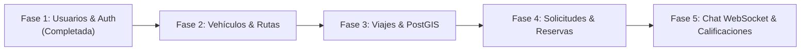

# 🚗 RUTEA - Plataforma de Carpooling El Salvador (API v1)

> **Plataforma inteligente de viajes compartidos (Carpooling) diseñada para conectar conductores y pasajeros, optimizando la movilidad urbana, reduciendo costos de transporte y disminuyendo el tráfico vehicular en El Salvador.**

---

## 🌟 1. Visión del Proyecto

### El Problema
En El Salvador y la región centroamericana, miles de personas se desplazan diariamente por rutas neurálgicas (como la Carretera Panamericana, Santa Ana ⇄ San Salvador, San Miguel, Sonsonate, Santa Tecla, etc.). Este flujo diario genera:
- Congestionamiento vehicular excesivo y tiempos muertos en carretera.
- Altos costos individuales de combustible y mantenimiento.
- Deficiencias en el transporte público tradicional (incomodidad, horarios rígidos, problemas de cobertura).
- Huella de carbono innecesaria provocada por miles de autos circulando con un solo ocupante.

### La Solución y Visión: Rutea
**Rutea** nace con la misión de transformar la movilidad diaria mediante un modelo colaborativo, eficiente, seguro y accesible:
- **Optimización de cupos**: Permitir que conductores que ya realizan una ruta diaria moneticen sus asientos vacíos compartiendo gastos.
- **Viajes económicos y cómodos**: Brindar a estudiantes y trabajadores una alternativa directa, económica y segura frente a los métodos de transporte convencionales.
- **Geolocalización precisa**: Aprovechar capacidades geoespaciales avanzadas (PostGIS) para definir orígenes, destinos y puntos de encuentro intermedios reales en la ruta.
- **Seguridad y confianza comunitaria**: Construir una red confiable basada en perfiles verificados, calificaciones bidireccionales y comunicación directa en tiempo real.

---

## 🏗️ 2. Arquitectura de Software

El núcleo del backend está construido siguiendo los principios de **Arquitectura Hexagonal (Ports & Adapters)** combinada con **Vertical Slice Architecture**, garantizando alta cohesión, bajo acoplamiento y facilidad de mantenimiento y testing:

```
src/main/java/com/carpooling/sv/v1/
├── auth/                                # Slice de Autenticación
│   ├── application/                     # Casos de uso (Login, Update) y Puertos
│   └── infra/                           # Adaptadores HTTP (REST), JWT, Cookies
├── usuario/                             # Slice de Gestión de Usuarios
│   ├── domain/                          # Entidades y Value Objects puros
│   ├── application/                     # Casos de uso CRUD, Roles y Puertos In/Out
│   └── infra/                           # Adaptadores JPA, PostgreSQL y Controladores
└── shared/                              # Componentes transversales
    ├── config/                          # OpenAPI/Swagger, DataInitializer
    ├── exception/                       # Manejador global de excepciones (RFC 7807)
    └── security/                        # Filtro JWT, Cookies HttpOnly, Spring Security
```

---

## 💻 3. Stack Tecnológico

| Capa / Herramienta | Tecnología | Detalle |
| :--- | :--- | :--- |
| **Lenguaje** | **Java 25** | Uso de records, pattern matching y características modernas del JDK |
| **Framework** | **Spring Boot 4.1.1** | Núcleo del API REST, inyección de dependencias y configuración |
| **Seguridad** | **Spring Security + JWT** | Autenticación híbrida: Cookies `HttpOnly` (Web) y Bearer Header (Móvil) |
| **Base de Datos** | **PostgreSQL 18 + PostGIS 3.6** | Persistencia relacional con soporte de datos y consultas geoespaciales |
| **ORM / Migraciones** | **Spring Data JPA + Flyway** | Acceso a datos de alto rendimiento y control de versiones del esquema |
| **Tiempo Real** | **Spring WebSocket + STOMP** | Soporte de mensajería y actualizaciones de viaje en vivo |
| **Documentación** | **SpringDoc OpenAPI 3 (Swagger)** | Documentación interactiva en `/swagger-ui.html` |
| **Infraestructura Local** | **Docker Compose** | Contenedor de base de datos con PostGIS preconfigurado |

---

## 📊 4. Estado Actual: Lo Que Tenemos Implementado

Actualmente, la versión base (**v1**) cuenta con los cimientos de infraestructura, seguridad y administración de usuarios:

- [x] **Infraestructura con Docker Compose**: Contenedor `postgis/postgis:18-3.6` listo con base de datos `rutea`.
- [x] **Seguridad Robusta de Doble Factor de Transporte**:
  - Tokens JWT con firma HMAC-SHA256 (`jjwt-api 0.12.6`).
  - Almacenamiento seguro en **Cookies `HttpOnly`** (`access_token`, `SameSite=Lax`) para prevenir robo por XSS.
  - Compatibilidad nativa con cabecera `Authorization: Bearer <token>` para clientes móviles y herramientas como Swagger/Postman.
- [x] **Inicialización Automática de Datos (`DataInitializer`)**:
  - Creación y mantenimiento automático del superusuario administrador (`admin@admin.com`).
- [x] **Módulo de Autenticación (`/api/v1/auth`)**:
  - `POST /login`: Autenticación con generación de token y cookie de sesión.
  - `POST /logout`: Invalidación y eliminación de la cookie de sesión.
  - `POST /register`: Registro público de nuevos usuarios.
  - `GET /me`: Consulta del perfil autenticado actual.
  - `POST /me/update`: Actualización de datos personales del perfil autenticado.
- [x] **Módulo de Usuarios (`/api/v1/usuarios`)**:
  - CRUD completo de usuarios con DTOs validados (`Jakarta Validation`).
  - Gestión de roles de acceso (`ADMIN`, `CONDUCTOR`, `CLIENTE`, `USUARIO`).
  - Control de estados de usuario (`ACTIVO`, `SUSPENDIDO`, `INACTIVO`).
- [x] **Mapeo del Modelo de Datos Relacional y Geoespacial (`sql/base.sql`)**:
  - Esquema completo diseñado para vehículos, rutas, viajes, puntos de encuentro, solicitudes, chat y calificaciones.
- [x] **Manejo Centralizado de Errores**:
  - `GlobalExceptionHandler` con respuestas estandarizadas para recursos duplicados, no encontrados, validaciones fallidas y accesos no autorizados.

---

## 🗺️ 5. Hoja de Ruta (Roadmap hacia el Producto Completo)



### Próximos Módulos a Desarrollar:
1. **Módulo de Vehículos (`vehiculos`)**:
   - Registro de automóviles de conductores (marca, modelo, año, placa, capacidad de pasajeros y fotografía).
2. **Módulo de Rutas y Puntos de Encuentro (`rutas` & `puntos_encuentro`)**:
   - Gestión de rutas maestras y paradas clave con coordenadas geográficas (`GEOGRAPHY(POINT, 4326)`).
3. **Módulo de Publicación y Búsqueda de Viajes (`viajes`)**:
   - Publicación de viajes con cupos disponibles, fecha, hora y tarifa calculada.
   - Búsqueda geoespacial por radio de proximidad (PostGIS `ST_DWithin` / `ST_Distance`).
4. **Módulo de Solicitudes y Reservas (`solicitudes_viaje`)**:
   - Flujo de reserva de cupos: Solicitud del pasajero $\rightarrow$ Aprobación/Rechazo del conductor $\rightarrow$ Actualización de cupos.
5. **Chat en Tiempo Real (`conversaciones` & `mensajes`)**:
   - Salas de chat para los ocupantes de cada viaje activo mediante WebSockets.
6. **Sistema de Calificaciones y Reputación (`calificaciones`)**:
   - Reseñas de 1 a 5 estrellas entre pasajeros y conductores tras finalizar el viaje.

---

## 🚀 6. Guía de Inicio Rápido (Desarrollo Local)

### Requisitos Previos
- **JDK 25** instalado y configurado en el `PATH`.
- **Docker** y **Docker Compose** en ejecución.

### 1. Iniciar la Base de Datos
Levanta el contenedor de PostgreSQL con PostGIS:
```bash
docker compose up -d
```

### 2. Estructura de la Base de Datos
Aplica el script de base de datos inicial:
```bash
psql -h localhost -U rutea -d rutea -f sql/base.sql
# Contraseña por defecto: rutea_dev
```

### 3. Compilar y Ejecutar el Backend
```bash
./gradlew bootRun
```

La aplicación se iniciará en el puerto `8080` (o el configurado en `application.properties`).

### 4. Acceder a la Documentación Interactiva
Abre en tu navegador:
```
http://localhost:8080/swagger-ui.html
```

### 5. Credenciales por Defecto
El sistema cuenta con un usuario Administrador precargado para pruebas:
- **Correo**: `admin@admin.com`
- **Contraseña**: `admin`

---

## 🔒 7. Licencia y Derechos de Autor

Este proyecto y su código fuente son de carácter **privado, propietario y confidencial**. Todos los derechos están estrictamente reservados por su autor.

Para más detalles sobre los términos legales y prohibición de copia o distribución a terceros, consulta el archivo [LICENSE](file:///home/alex/apis/v1/LICENSE).

---
Desarrollado con dedicación por **Alexander Avilés ([@alkeys](https://github.com/alkeys))**.
