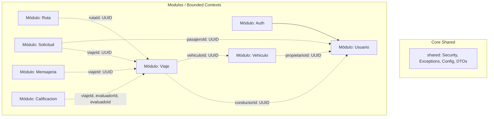
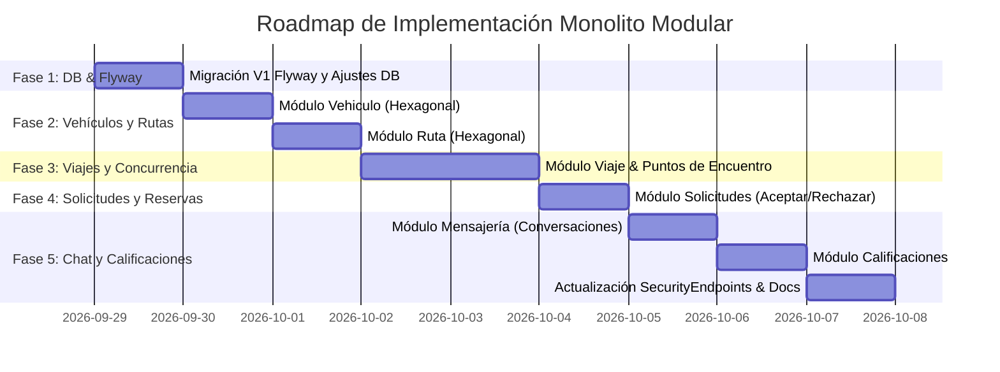

# Plan Maestro: Implementación de Módulos Restantes, Arquitectura Hexagonal y Seguridad Robusta

**Proyecto:** Rutea Carpooling El Salvador (API v1)  
**Estilo Arquitectural:** Monolito Modular con Arquitectura Hexagonal (Puertos y Adaptadores) y Vertical Slice Architecture  
**Tecnologías Clave:** Java 25, Spring Boot 4.1.1, Spring Data JPA / Hibernate 7, PostgreSQL + PostGIS, Flyway, Spring Security, JWT (Cookies HttpOnly + Bearer)

---

## 1. Diagnóstico y Revisión Exhaustiva de la Base de Datos (`sql/base.sql`)

Al analizar el script `sql/base.sql` y la configuración actual de Spring Boot / Flyway, se identificaron los siguientes hallazgos y elementos faltantes o a reforzar:

### 1.1. Estado de Migraciones y Flyway
* **Hallazgo:** El directorio `src/main/resources/db/migration` se encuentra vacío, a pesar de que las dependencias `spring-boot-starter-flyway` y `flyway-database-postgresql` están activas en `build.gradle`.
* **Mejora:** Mover `sql/base.sql` como la migración inicial `V1__init_schema.sql` en `src/main/resources/db/migration/` para garantizar reproducibilidad en cualquier entorno sin intervención manual.

### 1.2. Mapeo de Tipos Espaciales (PostGIS)
* **Hallazgo:** Las columnas `origen_geom`, `destino_geom` y `puntos_encuentro.ubicacion` están definidas como `GEOGRAPHY(POINT, 4326)`.
* **Solución Hexagonal:** 
  * En el **Dominio**, se usa un Value Object puro `Coordenada(double latitud, double longitud)` sin acoplamiento a librerías de GIS o Spring.
  * En la **Infraestructura (JPA)**, se transforma de forma transparente hacia y desde tipos PostGIS (`Point` o ST_MakePoint/ST_X/ST_Y).

### 1.3. Control de Concurrencia en Cupos (Race Conditions)
* **Hallazgo:** En `viajes`, `cupos_disponibles` disminuye cuando una solicitud es aceptada. Si dos conductores o solicitudes compiten por el último cupo, puede ocurrir sobreventa si no hay aislamiento o bloqueo.
* **Solución:** Implementar control de concurrencia optimista (`@Version` en JPA) o actualización atómica con bloqueo a nivel de repositorio (`SELECT ... FOR UPDATE` o `UPDATE viajes SET cupos_disponibles = cupos_disponibles - :cupos WHERE id = :id AND cupos_disponibles >= :cupos`).

### 1.4. Soft Delete en Vehículos
* **Hallazgo:** La tabla `vehiculos` no tiene bandera de estado o borrado lógico (`activo`). Si un usuario borra un vehículo que ya tuvo viajes históricos, un `DELETE` físico fallaría por integridad referencial (FK) o eliminaría viajes en cascada.
* **Solución:** Agregar columna `activo BOOLEAN NOT NULL DEFAULT TRUE` en la migración de vehículos.

### 1.5. Relación Viaje <-> Conversación y Participantes
* **Hallazgo:** Las tablas `conversaciones`, `participantes_conversacion` y `mensajes` modelan perfectamente un chat grupal por viaje.
* **Flujo Automatizado:**
  1. Al crear un viaje, se crea su registro en `conversaciones` y el conductor se añade a `participantes_conversacion`.
  2. Cuando una solicitud de viaje pasa a estado `ACEPTADA`, el pasajero se asocia automáticamente a `participantes_conversacion`.
  3. Si la solicitud se cancela antes del viaje, el participante puede ser removido o revocado del chat.

---

## 2. Mapa de Bounded Contexts y Arquitectura Vertical Slice

Cada módulo es un **Vertical Slice** autónomo. No hay dependencias circulares ni accesos directos a entidades JPA internas de otros módulos:



### Estructura Interna Estándar de cada Módulo (Hexagonal):
```
com.carpooling.sv.v1.<modulo>/
├── domain/                         # Núcleo Puro (Reglas de Negocio, Cero Frameworks)
│   ├── <Entidad>.java              # Entidad o Aggregate Root (Records / Java Puro)
│   └── value/                      # Value Objects y Enums del dominio
├── application/                    # Casos de Uso y Orquestación
│   ├── port/
│   │   ├── in/                     # Casos de uso (Interfaces primarias: Crear..., Listar...)
│   │   └── out/                    # Puertos secundarios (Interfaces para repositorios o eventos)
│   └── service/                    # Implementación de Casos de Uso (@Service, @Transactional)
└── infra/                          # Adaptadores de Entrada y Salida (Framework, DB, Web)
    ├── adapter/
    │   ├── in/
    │   │   └── web/                # REST Controllers, DTOs Request/Response, Validaciones
    │   └── out/
    │       └── persistence/        # Adaptadores JPA, SpringDataRepositories, JpaEntities, Mappers
```

---

## 3. Matriz de Endpoints y Clasificación de Seguridad

Analizamos detalladamente qué endpoints deben ser visibles desde el cliente (públicos vs cliente autenticado vs conductor vs admin) para garantizar un sistema seguro, ergonómico y que proteja contra **IDOR (Insecure Direct Object Reference)** y accesos no autorizados.

| Módulo | Método | Endpoint | Nivel de Acceso | Rol Requerido | Descripción y Reglas de Seguridad |
| :--- | :--- | :--- | :--- | :--- | :--- |
| **Auth** | POST | `/api/v1/auth/login` | Público | Ninguno | Inicia sesión, emite JWT en Cookie HttpOnly y payload. |
| **Auth** | POST | `/api/v1/auth/logout` | Público | Ninguno | Invalida y elimina la Cookie del navegador. |
| **Usuario** | POST | `/api/v1/usuarios` | Público | Ninguno | Registro inicial de usuarios / clientes. |
| **Usuario** | GET | `/api/v1/usuarios/me` | Autenticado | Cualquiera | Obtiene el perfil del usuario autenticado (extrae ID del JWT). |
| **Usuario** | PUT | `/api/v1/usuarios/me` | Autenticado | Cualquiera | Modifica datos propios (nombre, teléfono, foto). |
| **Usuario** | GET | `/api/v1/usuarios/{id}` | Autenticado | Cualquiera | Perfil público de otro usuario (oculta correo/teléfono/hash). |
| **Usuario** | GET | `/api/v1/usuarios` | Restringido | `ADMIN` | Listado completo de usuarios con datos administrativos. |
| **Usuario** | PUT | `/api/v1/usuarios/{id}/roles`| Restringido | `ADMIN` | Modifica roles del usuario (ej: habilitar como CONDUCTOR). |
| **Usuario** | PATCH| `/api/v1/usuarios/{id}/estado`| Restringido | `ADMIN` | Suspende, activa o inhabilita usuarios. |
| **Vehículo**| POST | `/api/v1/vehiculos` | Conductor | `CONDUCTOR`, `ADMIN` | Registra un nuevo vehículo para el conductor autenticado. |
| **Vehículo**| GET | `/api/v1/vehiculos/mis-vehiculos` | Conductor | `CONDUCTOR`, `ADMIN` | Lista solo los vehículos pertenecientes al usuario actual. |
| **Vehículo**| GET | `/api/v1/vehiculos/{id}` | Conductor / Admin | `CONDUCTOR`, `ADMIN` | Detalle del vehículo. **Anti-IDOR:** Debe ser el dueño o ADMIN. |
| **Vehículo**| PUT | `/api/v1/vehiculos/{id}` | Conductor / Admin | `CONDUCTOR`, `ADMIN` | Modifica vehículo. **Anti-IDOR:** Debe ser el dueño o ADMIN. |
| **Vehículo**| DELETE| `/api/v1/vehiculos/{id}` | Conductor / Admin | `CONDUCTOR`, `ADMIN` | Baja lógica del vehículo (`activo = false`). Dueño o ADMIN. |
| **Rutas** | GET | `/api/v1/rutas` | Público | Ninguno | Catálogo de rutas frecuentes para explorar en la app. |
| **Rutas** | GET | `/api/v1/rutas/{id}` | Público | Ninguno | Detalle de una ruta preestablecida. |
| **Rutas** | POST | `/api/v1/rutas` | Restringido | `ADMIN` | Creación de nuevas rutas en el catálogo maestro. |
| **Rutas** | PUT | `/api/v1/rutas/{id}` | Restringido | `ADMIN` | Edición de rutas del catálogo. |
| **Rutas** | DELETE| `/api/v1/rutas/{id}` | Restringido | `ADMIN` | Desactivación de ruta en catálogo. |
| **Viajes** | GET | `/api/v1/viajes/buscar` | Público | Ninguno | Búsqueda por origen, destino, fecha y cupos disponibles. |
| **Viajes** | GET | `/api/v1/viajes/{id}` | Público | Ninguno | Detalle completo de un viaje y sus puntos de encuentro. |
| **Viajes** | POST | `/api/v1/viajes` | Conductor | `CONDUCTOR`, `ADMIN` | Publicar nuevo viaje. Valida que el vehículo pertenezca al conductor. |
| **Viajes** | GET | `/api/v1/viajes/mis-viajes`| Conductor | `CONDUCTOR`, `ADMIN` | Lista los viajes publicados por el conductor autenticado. |
| **Viajes** | PUT | `/api/v1/viajes/{id}` | Conductor | `CONDUCTOR`, `ADMIN` | Modificar datos del viaje. **Anti-IDOR:** Solo dueño en estado PUBLICADO. |
| **Viajes** | PATCH| `/api/v1/viajes/{id}/estado` | Conductor | `CONDUCTOR`, `ADMIN` | Transición: INICIAR (EN_CURSO), FINALIZAR o CANCELAR. |
| **Viajes** | POST | `/api/v1/viajes/{id}/puntos` | Conductor | `CONDUCTOR`, `ADMIN` | Añade paradas/puntos de encuentro intermedias. Dueño del viaje. |
| **Solicitudes**| POST| `/api/v1/solicitudes-viaje`| Pasajero | `CLIENTE`, `ADMIN` | Solicita N cupos para un viaje. Valida que no sea el conductor. |
| **Solicitudes**| GET | `/api/v1/solicitudes-viaje/mis-solicitudes` | Pasajero | `CLIENTE`, `ADMIN` | Historial de solicitudes emitidas por el pasajero logueado. |
| **Solicitudes**| GET | `/api/v1/solicitudes-viaje/viaje/{viajeId}` | Conductor | `CONDUCTOR`, `ADMIN` | Solicitudes recibidas en el viaje. Dueño del viaje o ADMIN. |
| **Solicitudes**| PATCH| `/api/v1/solicitudes-viaje/{id}/responder` | Conductor | `CONDUCTOR`, `ADMIN` | Aceptar o Rechazar. Dueño del viaje. Si acepta: descuenta cupos y añade a chat. |
| **Solicitudes**| PUT | `/api/v1/solicitudes-viaje/{id}/cancelar` | Pasajero | `CLIENTE`, `ADMIN` | Cancela solicitud. Solo el pasajero solicitante antes del viaje. |
| **Mensajería**| GET | `/api/v1/conversaciones/viaje/{viajeId}` | Participante | Autenticado | Obtiene la conversación grupal del viaje. Valida participación. |
| **Mensajería**| GET | `/api/v1/conversaciones/{id}/mensajes` | Participante | Autenticado | Historial paginado de mensajes. Valida que el usuario participe. |
| **Mensajería**| POST| `/api/v1/conversaciones/{id}/mensajes` | Participante | Autenticado | Envía mensaje al chat. Valida que el usuario participe. |
| **Mensajería**| PATCH| `/api/v1/mensajes/{id}/leido` | Participante | Autenticado | Marca mensaje como leído por el participante. |
| **Calificación**| POST| `/api/v1/calificaciones` | Participante | Autenticado | Califica al conductor o pasajero tras estado FINALIZADO. |
| **Calificación**| GET| `/api/v1/calificaciones/usuario/{id}` | Público | Ninguno | Muestra promedio de estrellas y reseñas públicas recibidas. |
| **Calificación**| GET| `/api/v1/calificaciones/viaje/{viajeId}` | Autenticado | Cualquiera | Lista calificaciones registradas de un viaje finalizado. |

---

## 4. Pilares de Seguridad Robusta

### 4.1. Prevención Integral de IDOR (Insecure Direct Object Reference)
Para evitar que un atacante manipule UUIDs en la URL para leer o modificar recursos ajenos:
1. **Helper de Seguridad Centralizado:** Creación de un componente `SecurityContextHelper` que obtiene el UUID y roles del usuario autenticado en el `SecurityContext`.
2. **Validación de Propiedad a Nivel de Servicio / PreAuthorize:**
   * En `Vehiculo`: Verificar `vehiculo.propietarioId().equals(userId)`.
   * En `Viaje`: Verificar `viaje.conductorId().equals(userId)`.
   * En `Solicitud`: Verificar que solo el pasajero puede cancelar su solicitud, y solo el conductor del viaje puede aceptarla/rechazarla.
   * En `Mensajería`: Verificar membresía en `participantes_conversacion` antes de retornar o publicar mensajes.

### 4.2. Autenticación Híbrida y Protección contra CSRF / XSS
* **Cookie HttpOnly (`access_token`):** Máxima seguridad para aplicaciones web front-end (React/Vue/Next/Angular), impidiendo que scripts maliciosos de JavaScript roben el token.
* **Header `Authorization: Bearer <token>`:** Compatibilidad transparente con apps móviles (iOS/Android) y Swagger UI.
* **Filtro JWT:** `JwtAuthenticationFilter` extrae el token con prioridad en la Cookie y soporte alternativo en el Header Authorization.

### 4.3. Validación Estricta de Entradas (Defense in Depth)
* DTOs con Bean Validation (`@NotNull`, `@NotBlank`, `@Size`, `@Min`, `@Max`, `@Pattern`).
* Sanitización de cadenas de texto para evitar ataques de inyección HTML/Scripting en comentarios de calificaciones y mensajes de chat.

---

## 5. Hoja de Ruta de Implementación por Fases



### Detalle de las Fases:
* **Fase 1: Base de Datos y Migración Flyway**
  * Crear `src/main/resources/db/migration/V1__init_schema.sql` basado en `sql/base.sql` con el campo `activo` en `vehiculos`.
  * Configurar `SecurityContextHelper` para extracción limpia del usuario actual.
* **Fase 2: Bounded Context `vehiculo` y `ruta`**
  * Implementar modelo de dominio, puertos, casos de uso, repositorio JPA y controlador REST para vehículos (validación de propiedad anti-IDOR).
  * Implementar catálogo de rutas para administradores y consulta pública.
* **Fase 3: Bounded Context `viaje`**
  * Modelado de dominio con `Coordenada(lat, lon)` y `EstadoViaje`.
  * Publicación de viajes (valida que el vehículo pertenezca al conductor).
  * Búsqueda y filtrado de viajes (público).
  * Puntos de encuentro asociados.
* **Fase 4: Bounded Context `solicitud`**
  * Casos de uso: Solicitar cupos, Aceptar solicitud (descuenta cupos con protección contra race conditions), Rechazar solicitud, Cancelar solicitud.
* **Fase 5: Bounded Contexts `mensajeria` y `calificacion`**
  * `mensajeria`: Creación automática de conversación al publicar viaje, adhesión de pasajero al ser aceptado, envío y lectura de mensajes.
  * `calificacion`: Reseñas mutuas tras viaje FINALIZADO, cálculo de reputación media por usuario.
  * Integración en `SecurityEndpoints` y verificación final de compilación y documentación Swagger.

---

## 6. Estado Final de la Implementación (100% COMPLETADO)

Todos los módulos del monolito modular fueron implementados siguiendo estrictamente Arquitectura Hexagonal (Ports & Adapters) y Vertical Slice Architecture:

| Módulo | Casos de Uso / In-Ports | Puertos de Salida / Adapters | Controlador REST & Endpoints | Tests de Integración |
| :--- | :--- | :--- | :--- | :---: |
| **`usuario`** | CRUD, Perfil `/me`, Roles, Estados | `UsuarioRepositoryPort` -> `JpaUsuarioAdapter` | `UsuarioController` | ✅ PASÓ |
| **`vehiculo`** | Registro, Actualización, Baja lógica, Consulta | `VehiculoRepositoryPort` -> `JpaVehiculoAdapter` | `VehiculoController` | ✅ PASÓ |
| **`ruta`** | Creación, Activación/Inactivación, Catálogo público | `RutaRepositoryPort` -> `JpaRutaAdapter` | `RutaController` | ✅ PASÓ |
| **`viaje`** | Publicación, Búsqueda Geoespacial PostGIS, Paradas, Ciclo de vida | `ViajeRepositoryPort` -> `JpaViajeAdapter`, `VehiculoVerificationPort` | `ViajeController` | ✅ PASÓ |
| **`solicitud`** | Reservar cupo, Concurrencia atómica, Aceptar/Rechazar, Cancelar | `SolicitudRepositoryPort` -> `JpaSolicitudAdapter` | `SolicitudController` | ✅ PASÓ |
| **`mensajeria`**| Chat grupal por viaje, Auto-unión de confirmados, Historial | `MensajeriaRepositoryPort` -> `JpaMensajeriaAdapter` | `MensajeriaController` | ✅ PASÓ |
| **`calificacion`**| Reseña mutua post-viaje, Anti-autocalificación, Reputación pública | `CalificacionRepositoryPort` -> `JpaCalificacionAdapter` | `CalificacionController` | ✅ PASÓ |

### Métricas de Calidad y Seguridad:
* **Pruebas Automatizadas:** 61 tests de integración ejecutados y pasando 100% verde (`./gradlew test`).
* **Protección Anti-IDOR:** 100% de los endpoints autenticados validan que el `currentUserId` extraído del JWT sea el propietario del recurso o tenga privilegios administrativos (`ROLE_ADMIN`).
* **Seguridad Híbrida JWT:** Soporte para Cookies `HttpOnly` (máxima seguridad contra XSS para SPA/Web) y Header `Authorization: Bearer` (soporte nativo para Mobile Apps).
* **Manejo de Transacciones & Concurrencia:** Los cupos de los viajes se descuentan de forma atómica en la base de datos al aceptar solicitudes y se reintegran automáticamente al cancelar.

